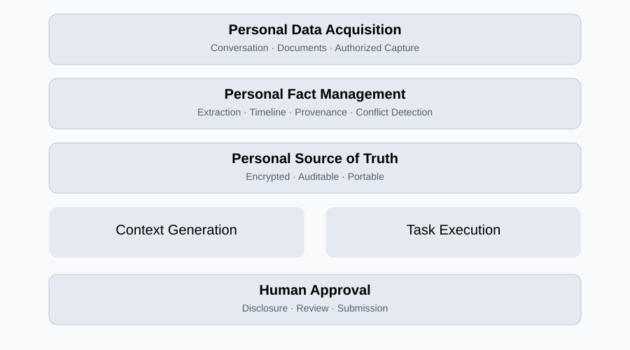
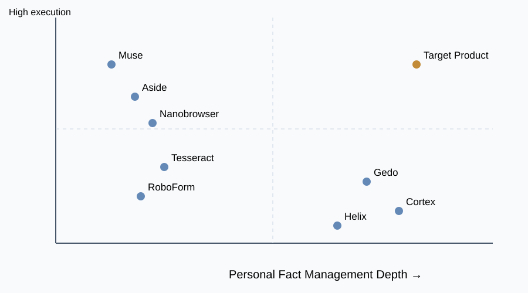
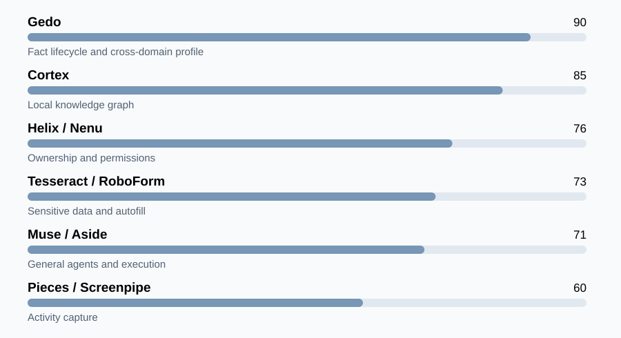

# 「别再问我」竞品分析报告

Don't Ask Me Again｜Personal System of Record + Local AI Agent

研究日期：2026 年 11 月 9 日｜目标平台：macOS / iOS｜产品模式：商业闭源、本地优先

## 一、执行摘要

「别再问我」计划开发一款面向普通消费者的个人信息管理与 AI Agent 软件。产品以用户本人为中心，通过自然语言对话、文件导入和用户授权的信息采集，持续建立、核实、更新和管理个人资料。

系统利用本地 AI 理解用户的需求，从个人信息库中提取相关事实，生成移民、职业、医疗、保险、教育等不同场景所需的资料，并通过屏幕识别和自动填表协助用户完成实际任务。

### 核心研究结论

1. **个人 AI 记忆市场已经存在直接竞争者。** Gedo、Cortex、Helix、Nenu 等产品覆盖了个人信息积累、结构化管理、记忆更新和授权共享等能力。
2. **自动填表和桌面操作已有较成熟的解决方案。** RoboForm、Bitwarden、Tesseract、Nanobrowser、Muse 等产品分别覆盖身份信息管理、字段匹配、屏幕理解和任务执行。
3. **本地优先的个人知识系统已有技术先例。** Cortex、Memex、Companion Memory、Pieces 和 Screenpipe 证明本地数据存储、个人活动检索和本地模型集成具有技术可行性。
4. **尚未发现有充分证据证明某款成熟的 Apple 消费级产品完整覆盖全部目标能力。** 但这只能说明公开验证存在缺口，不能证明市场没有同类产品。
5. **建议以个人事实生命周期管理作为核心竞争力。** AI 推理、检索和自动操作是重要能力，但更值得建立长期壁垒的是准确、完整、可追溯、可更新、可授权使用的个人事实数据库。

---

## 二、产品定义与竞争范围

### 2.1 产品定位

**Personal System of Record + Local AI Agent**

一个由用户控制的个人事实系统，长期管理用户的身份、经历、关系、文件和生活记录，并将这些信息安全地用于不同的现实任务。

产品具有三个核心价值：

| 核心价值 | 产品能力 | 用户收益 |
|---|---|---|
| Know Me | 对话积累、事实识别、历史更新 | 减少重复解释个人背景 |
| Organize Me | 结构化存储、证据管理、时间线、冲突检测 | 获得完整可信的个人档案 |
| Act for Me | 场景资料生成、屏幕识别、自动填表、提交审核 | 减少重复劳动与信息错误 |

### 2.2 产品功能边界

### 2.3 竞争分析的评价维度

本报告采用以下六个维度比较产品：

| 维度 | 关键评价内容 |
|---|---|
| 个人事实管理 | 能否持续提取、存储、修改、删除个人事实 |
| 生命周期管理 | 是否支持时间线、事实替代、来源、冲突和版本 |
| 跨领域整合 | 能否覆盖职业、家庭、财务、医疗等多个领域 |
| 隐私架构 | 本地存储、本地推理、加密、权限和数据导出 |
| 专业资料生成 | 能否针对不同专业需求组织完整资料 |
| 任务执行 | 是否支持屏幕理解、自动填写和提交审批 |

---

## 三、竞品市场结构

目前竞争者可以分为五类。

| 竞争类别 | 代表产品 | 核心优势 | 与目标产品的关系 |
|---|---|---|---|
| 个人事实与 AI 记忆 | Gedo、Cortex、Helix、Nenu、Arca、Memrov | 长期记忆、事实管理、数据授权 | 核心直接竞品 |
| 个人生活记录 | Kin、Memex、Companion Memory、Pieces、Screenpipe | 生活信息捕获、时间线、上下文 | 数据采集与管理竞品 |
| 身份信息与填表 | RoboForm、1Password、Bitwarden、Tesseract | 敏感信息存储、表格匹配 | 功能直接竞品 |
| 通用 AI Agent | Muse、Aside、nanoMuse、Nanobrowser、HeyPace | 页面理解、任务执行、人工审批 | 执行能力竞品 |
| AI 与本地基础设施 | Ollama、LM Studio、MLX、Apple Foundation Models | 本地推理、模型集成 | 技术基础设施及潜在平台威胁 |

## 四、核心直接竞品分析

### 4.1 个人事实管理与长期记忆

**Gedo**

定位：跨领域个人记忆与人生信息管理

将健康、职业、家庭、财务、成长、关系等资料组织为长期记忆。公开描述包含信息来源检查、冲突处理、待确认事实、旧事实替代和修改日志。

**竞争意义：** 已覆盖目标产品的事实生命周期管理核心理念，属于最直接的概念竞争者。

[官方网站](https://gedo.ai/)

**Cortex**

定位：本地个人知识图谱与 AI 上下文层

采用 SwiftUI、SQLite、结构化记忆、知识图谱和来源追踪。将用户信息转换成适合不同 AI 使用的上下文。

**竞争意义：** 与 Apple 本地优先路线高度接近，是技术架构和数据模型的重要参照。

[GitHub 项目](https://github.com/trace-cortex/cortex-app)

**Helix**

定位：个人事实所有权与跨 AI 授权

支持自然语言保存个人事实、用户确认记忆、按类别授权 AI 读取，以及审计与撤销访问。

**竞争意义：** 在用户授权、数据主权和记忆共享方面具有高度相关性。

[官方网站](https://www.helix.ai/)

**Nenu**

定位：多领域个人信息聚合与选择性披露

聚合健康、财务、教育、旅行等资料，支持不同信息类别和不同粒度的分享权限。

**竞争意义：** 个人信息覆盖范围和隐私权限设计值得参考。

[官方网站](https://us.nenu.co/)

### 4.2 个人生活记录与数字档案

| 产品 | 核心能力 | 优势 | 对目标产品的启示 |
|---|---|---|---|
| Companion Memory | 设备和外部数据整合、人物事件时间线、本地数字档案 | 多来源生活信息整合 | 建立人物、地点、事件关系模型 |
| Kin | 长期个人上下文、关系与价值观记忆 | 对话式个人理解 | 降低档案维护的交互成本 |
| Memex | 文字、照片、语音整理为结构化时间线 | 本地优先、自然记录 | 从碎片信息提取事实 |
| Pieces | 工作活动捕获、时间线、上下文检索 | 自动收集工作记录 | 减少用户手动录入 |
| Screenpipe | 屏幕和音频捕获、OCR、搜索 | 本地活动记录 | 支持用户授权的屏幕数据采集 |

这些产品解决了个人信息采集和检索问题，但通常缺少面向正式申请的事实核验、资料完整性检查和跨领域表格执行流程。

### 4.3 身份管理与智能填表

| 产品 | 核心能力 | 主要优势 | 主要差异 |
|---|---|---|---|
| RoboForm | Identity、证件、地址、银行资料、自定义字段、自动填表 | 结构化身份信息与成熟填充机制 | 不以完整人生事实管理为中心 |
| Bitwarden | 密码保险库、身份字段、自定义字段匹配 | 加密、跨设备、规则填充 | 复杂语义与历史事实管理有限 |
| 1Password | 身份、凭据、证件等敏感资料 | 安全性、生态与用户信任 | 更偏凭据和固定身份资料 |
| Tesseract | 敏感资料保险库、智能字段匹配 | 规则与模型结合的填表架构 | 跨领域长期事实管理尚不明确 |

这类竞品已经覆盖大量固定字段的自动填充，因此「别再问我」应重点解决复杂字段和历史信息。

例如，普通填表器能够填写当前地址，而目标产品应能够回答“过去五年所有居住地址及对应时间段”，并标注证据与缺失记录。

### 4.4 通用 Agent 与屏幕执行

| 产品 | 主要能力 | 竞争威胁 |
|---|---|---|
| Meta Muse | 长期记忆、跨应用操作、表格填写、关键操作审批 | 大型平台的功能整合能力 |
| Aside | AI 浏览器、本地记忆、凭据保险库、授权操作 | 隐私与自动化结合 |
| nanoMuse | 跨设备 Agent、Markdown 记忆、桌面操作 | 可自托管 Agent 架构 |
| HeyPace | 本地 Mac AI、OCR、Accessibility、屏幕理解 | Apple 桌面操作技术 |
| Nanobrowser | 本地模型、浏览器操作、表单填写、人工审批 | 网页自动化能力 |

这些产品是执行层的重要竞争者。

它们可能在任务规划和自动操作方面比专门的个人事实管理软件更强，但其核心产品通常没有围绕个人事实准确性、来源和历史版本建立完整的数据治理流程。

---

## 五、竞品能力矩阵

✓：公开资料明确支持；△：部分支持或可配置；—：未发现充分公开证据。符号不代表独立实测。

| 产品 | 事实管理 | 生命周期 | 跨领域整合 | 本地能力 | 自动填表 |
|---|---|---|---|---|---|
| Gedo | ✓ | ✓ | ✓ | 未确认 | — |
| Cortex | ✓ | ✓ | △ | ✓ | — |
| Helix | ✓ | △ | ✓ | 未确认 | — |
| Nenu | ✓ | △ | ✓ | 未确认 | — |
| Companion Memory | ✓ | ✓ | ✓ | ✓ | — |
| Kin | ✓ | △ | ✓ | 未确认 | — |
| Memex | ✓ | ✓ | △ | ✓ | — |
| Pieces | △ | ✓ | △ | ✓ | — |
| Screenpipe | △ | △ | △ | ✓ | — |
| RoboForm | △ | △ | △ | ✓（存储） | ✓ |
| Tesseract | △ | △ | △ | 部分 | ✓ |
| Meta Muse | △ | △ | △ | 云端 | ✓ |
| Aside | △ | △ | △ | 部分 | ✓ |
| Nanobrowser | △ | — | — | 可配置 | ✓ |
| 别再问我（目标） | ✓ | ✓ | ✓ | ✓ | ✓ |

这里的“本地能力”不能统一理解为本地模型推理。例如 RoboForm 的本地存储能力，与 Cortex 的本地知识系统、Nanobrowser 的可配置本地模型属于不同技术层次。

### 竞争定位图

定性定位示意，依据已讨论的公开功能。目标产品坐标代表规划愿景，不代表现有产品能力。

---

## 六、核心竞争发现

### 6.1 个人事实管理已经形成独立竞争领域

Gedo、Cortex、Helix 和 Nenu 表明，个人记忆正在从通用聊天 AI 的附属功能发展为独立的数据产品。

其中 Gedo 的事实更新与冲突处理机制、Cortex 的本地知识图谱，以及 Helix 的访问授权体系，与目标产品高度重合。

因此，长期记忆、事实结构化和数据主权本身不足以构成独家优势。

### 6.2 个人资料的准确性与可验证性仍值得深入开发

个人信息系统需要处理不同性质的记录：

- 用户明确确认的事实。
- 官方文件支持的事实。
- 第三方提供的信息。
- 用户个人感受或主观叙述。
- AI 推断或尚待确认的信息。

还需要处理事实变化。例如住址、婚姻状态、工作、教育和证件有效期可能随时间改变，系统必须保留历史，避免覆盖后丢失。

这使得 Personal Record System 的要求明显高于普通 AI Memory。

### 6.3 跨领域专业资料生成具有差异化潜力

目标产品可以从同一个个人事实库中，针对不同专业需求组织不同资料。

| 场景 | 核心信息 | 关键质量要求 |
|---|---|---|
| 移民与签证 | 身份、出入境、地址、婚姻、教育、工作历史 | 时间连续、证据完整 |
| 职业咨询 | 技能、项目、教育、工作经历、职业目标 | 经历准确、目标清晰 |
| 医疗就诊 | 症状、用药、检查、健康事件 | 时间准确、来源明确 |
| 心理咨询 | 人生事件、关系、压力、感受 | 保留主观性、用户控制披露 |
| 保险与福利 | 家庭、财务、健康、身份记录 | 字段一致、信息有效 |
| 教育申请 | 学历、成绩、活动、项目、推荐材料 | 申请间事实一致 |

跨领域资料生成的竞争价值来自完整性、事实准确率、证据可追溯性及信息披露控制，而不只是生成文字的流畅程度。

### 6.4 自动填表是产品执行能力，未必是长期壁垒

浏览器 Agent、密码管理器和 AI 操作系统都在发展自动填表。

因此，应当将自动填表作为个人事实系统的执行接口，通过稳定的规则匹配、页面理解和用户审批实现可靠操作。

最重要的区别是：目标产品知道某个答案为什么正确、何时有效、来自哪条记录，以及是否适合向当前服务披露。

### 6.5 本地隐私架构既是优势，也是技术成本

本地优先能够减少开发者云端存储敏感信息的需求，但需要解决：

- 本地模型的准确率、性能与设备兼容性。
- 加密数据库和密钥恢复。
- 多设备数据同步与冲突处理。
- 浏览器页面的提示注入攻击。
- 截图和外部网页中的敏感数据泄露。
- 用户授权、撤销和审计。
- 数据丢失后的备份恢复。

闭源商业软件还需要通过安全设计、透明权限和独立审计建立信任。

---

## 七、竞争机会与差异化战略

### 7.1 建议的核心差异化

| 战略能力 | 产品实现 | 竞争价值 |
|---|---|---|
| Personal Fact Graph | 事实、人物、地点、事件、关系、时间 | 复杂个人背景理解 |
| Fact Lifecycle | 创建、确认、修改、失效、替代、历史记录 | 长期准确性 |
| Evidence Tracking | 关联原始文件、对话和证明材料 | 事实可追溯 |
| Context Assembly | 按场景提取和组织相关事实 | 跨领域资料生成 |
| Disclosure Control | 字段级授权、选择性披露 | 隐私保护 |
| Form Execution | 页面理解、字段匹配、填充、审核 | 完成实际任务 |
| Local-first Architecture | 本地模型、加密数据库、数据导出 | 用户数据主权 |

### 7.2 核心产品壁垒

建议将研发投入优先放在以下三个方面。

**第一：可信个人事实数据库。** 建立支持时间、来源、版本、关系和不确定性的结构化模型。确保模型不会擅自将推断转化为事实。

**第二：跨场景资料完整性引擎。** 针对不同任务检查所需信息，发现时间线缺口、证据缺失、资料冲突和过期信息，并让用户补充。

**第三：隐私权限与执行系统。** 确保本地模型只能读取必要信息，Agent 只能向经过授权的目标填写相应字段，最终提交由用户控制。

---

## 八、商业定位与目标用户

### 8.1 目标用户优先级

| 用户群体 | 信息复杂度 | 使用频率 | 价值潜力 |
|---|---|---|---|
| 留学生、移民申请者、跨国生活者 | 高 | 中 | 高 |
| 求职者、职业转换者 | 中高 | 中高 | 中高 |
| 长期管理医疗资料的人群 | 高 | 中 | 高 |
| 保险、福利和家庭事务申请者 | 高 | 中 | 中高 |
| 普通隐私敏感消费者 | 中 | 不确定 | 需验证 |

上述判断属于产品假设，目前没有足够的市场调查数据证明具体群体的支付意愿和留存率。

### 8.2 建议的市场切入点

优先选择 **复杂个人申请资料管理**，以移民、求职、教育申请等场景作为初期验证对象。

原因在于这些场景有相对明确的信息字段、文件要求和可测量的任务完成结果。

医疗和心理咨询资料整理可以作为后续扩展场景，需要更严格的隐私、安全和准确性设计。

### 8.3 商业模式

建议测试一次性买断与付费大版本升级模式，同时评估可选的高级功能收费。

闭源软件可以使用允许商业分发的本地模型和开源依赖，但需要逐项核实模型权重、代码及第三方组件的许可证。

用户数据应当保持可导出、可备份、可删除，避免形成数据锁定。

---

## 九、产品研发路线

1. **Phase 1 — Personal Record Core**

   macOS 本地应用、自然语言录入、文件导入、事实提取、结构化存储、来源管理、时间线、冲突检测和加密数据库。

   验收重点：事实提取准确率、历史信息保留率、用户纠错成本。

2. **Phase 2 — Professional Context Packs**

   根据移民、职业、教育等任务生成资料包，支持完整性检查、证据关联、信息缺失提示和用户编辑。

   验收重点：资料完整率、用户确认时间、专业场景可用性。

3. **Phase 3 — Screen & Form Agent**

   集成 Safari DOM、macOS Accessibility、Apple Vision OCR 和本地模型，支持表单理解、字段匹配、自动填写与提交前审核。

   验收重点：字段准确率、错误披露率、任务完成率。

4. **Phase 4 — iOS & Cross-device**

   iPhone 资料管理、文件扫描、对话更新、用户审批，以及可选的端到端加密设备同步。

   验收重点：设备间一致性、同步冲突率、恢复可靠性。

---

## 十、风险与待验证问题

| 风险 | 影响 | 建议验证方式 |
|---|---|---|
| 用户不愿录入大量隐私资料 | 高 | 测试对话录入与文件导入的完成率 |
| AI 提取错误事实 | 很高 | 建立人工标注的事实测试集 |
| 信息库长期过期 | 高 | 测试主动更新和失效提醒 |
| 本地模型能力不足 | 高 | 多设备推理性能与准确率测试 |
| Agent 错误披露信息 | 很高 | 权限隔离、提示注入与安全测试 |
| Apple 系统权限限制 | 高 | 早期验证 Safari 与 macOS API |
| 平台 AI 增加类似功能 | 高 | 强化专业资料与数据治理能力 |
| 用户付费意愿不足 | 高 | 原型测试、付费实验与留存研究 |

## 十一、竞争威胁优先级

主观竞争威胁排序，用于研发优先级讨论，不代表量化市场数据。

## 十二、最终结论

「别再问我」所处的市场已经出现多个直接和相邻竞争者。Gedo 和 Cortex 尤其接近产品的信息管理核心，Helix 和 Nenu 代表个人数据授权方向，Tesseract 和 RoboForm 代表智能填表方向，Muse 和 Aside 则代表通用 Agent 的平台竞争。

当前仍值得探索的机会，是将以下能力整合成面向普通消费者的可靠产品：

**个人事实生命周期管理 + 跨领域专业资料生成 + 本地隐私保护 + 用户授权的任务执行。**

但整合功能本身不会自动形成竞争壁垒。长期竞争力取决于事实准确性、来源可验证性、资料完整度、用户信任和任务完成质量。

建议将产品定位为：

**Don't Ask Me Again — Your Personal Source of Truth.**

一个长期保存、核实和管理个人事实的本地 AI 系统，让用户能够在不同生活场景中安全复用自己的信息。

---

## 十三、主要竞品研究入口

| 产品 | 官方资料 |
|---|---|
| Gedo | [官网](https://gedo.ai/) |
| Cortex | [GitHub](https://github.com/trace-cortex/cortex-app) |
| Helix | [官网](https://www.helix.ai/) |
| Nenu | [官网](https://us.nenu.co/) |
| Companion Memory | [技术文档](https://docs.ci.computer/docs/apps-available/first-party-apps/companion-memory-server) |
| Memex | [官网](https://www.memexlab.ai/) |
| Aside | [官网](https://aside.com/) |
| Nanobrowser | [技术文档](https://www.nanobrowser.ai/docs) |
| Screenpipe | [官网](https://screenpi.pe/) |
| RoboForm | [官网](https://www.roboform.com/) |
| Bitwarden | [官网](https://bitwarden.com/) |
| Apple App Review | [审核指南](https://developer.apple.com/app-store/review/guidelines/) |

研究限制：本报告整合前述竞品研究内容及其公开资料，尚未进行逐个产品的安装实测、付费功能验证、第三方安全审计或市场规模调查。对于未证实的功能、产品成熟度和本地推理能力，应在正式商业决策前进一步核验。